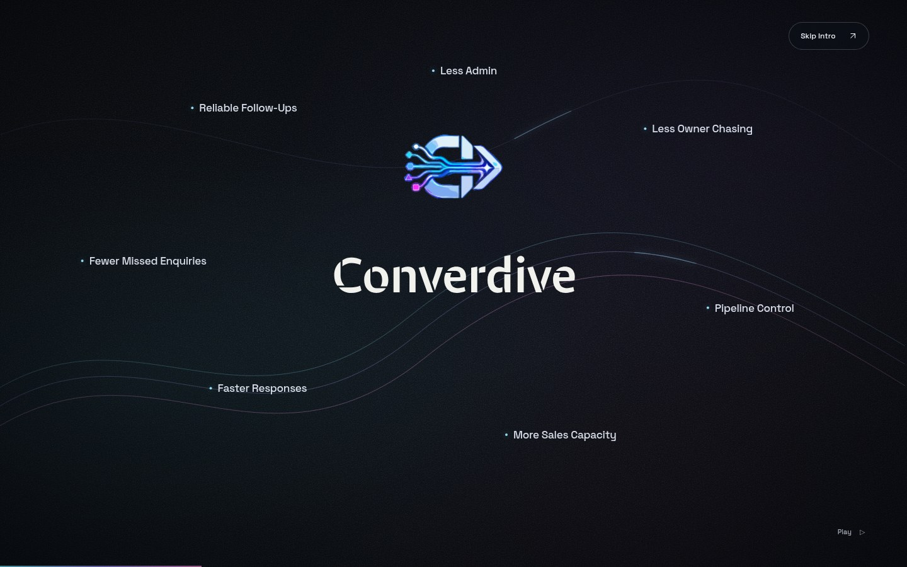
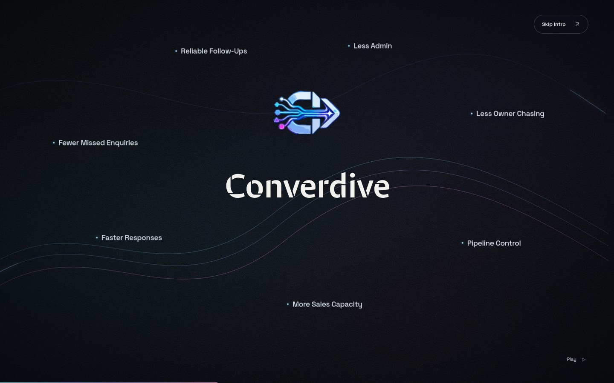
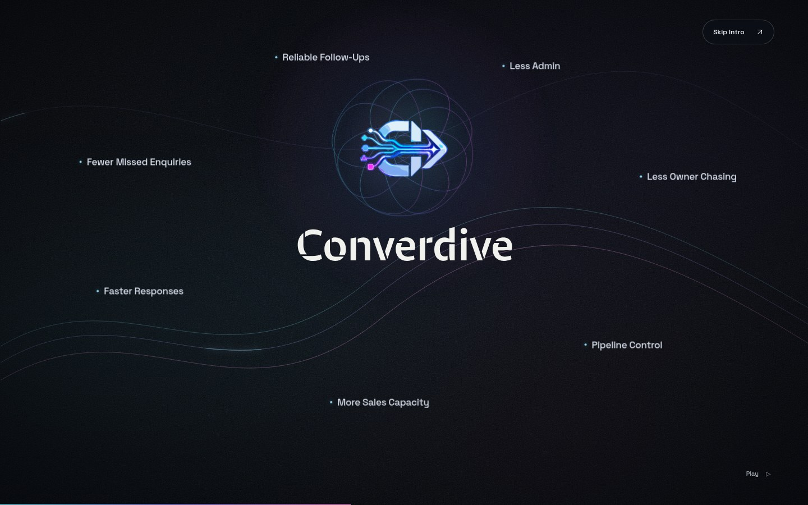
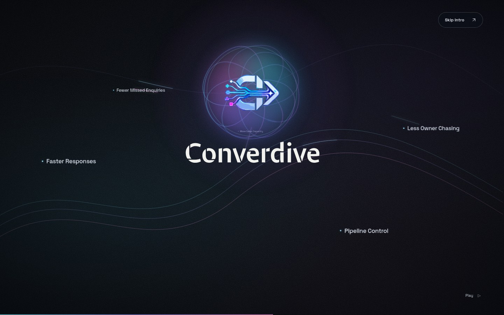
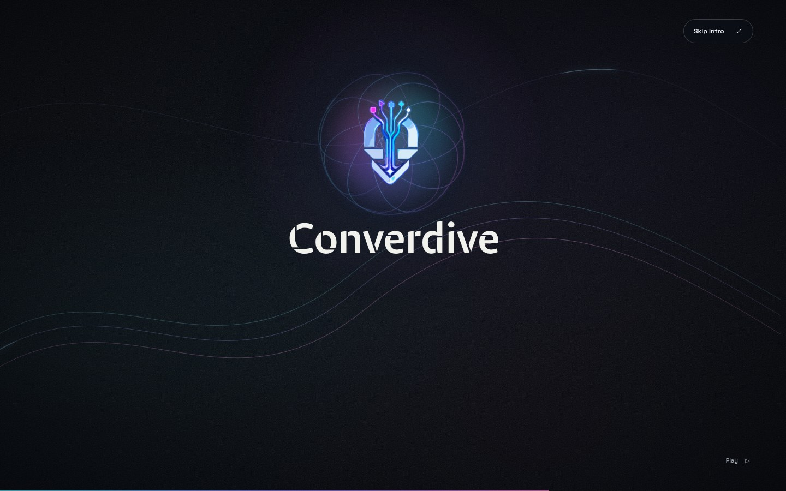
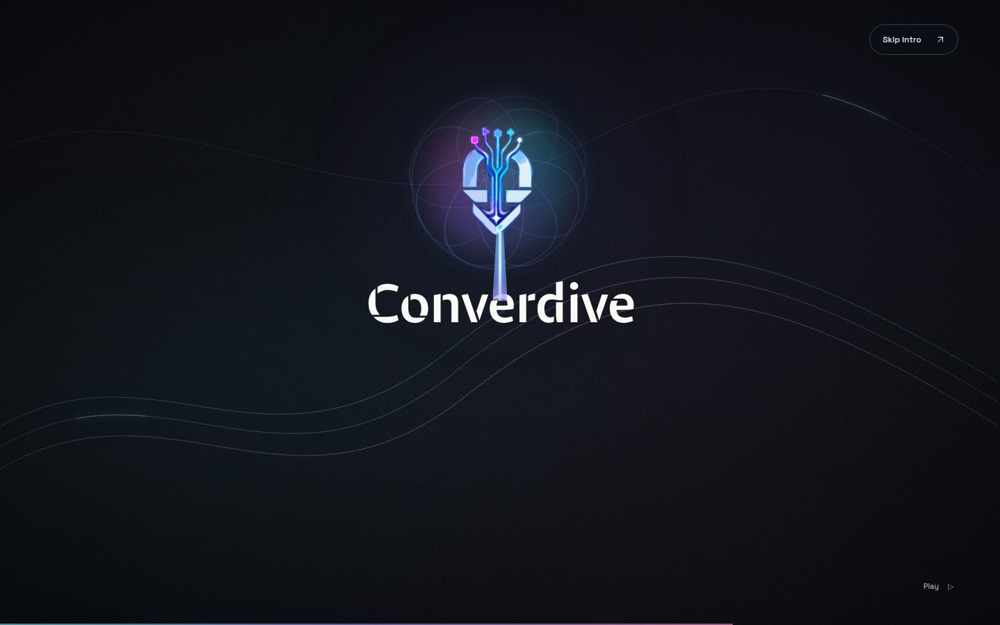
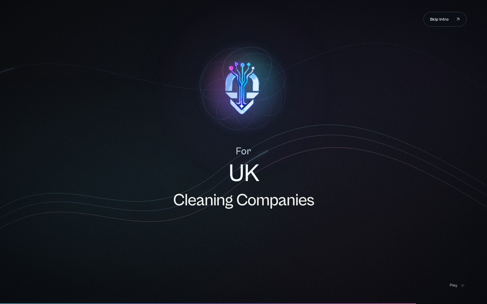
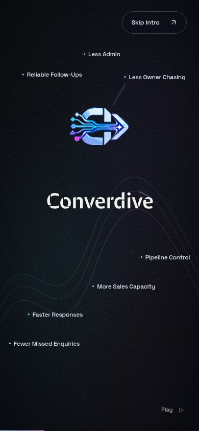
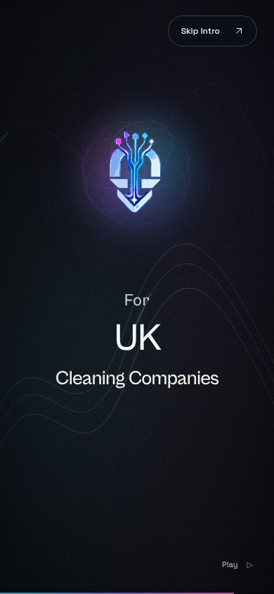

# Converdive V3 intro review

[Play the private preview](https://converdive-intro-preview.longgala1.chatgpt.site/?intro=1) · [Pause and scrub](https://converdive-intro-preview.longgala1.chatgpt.site/?intro=review)

Sign in with the owning ChatGPT account if prompted. The approved artwork and homepage handoff are preserved. V3 adds expanded orbital motion, responsive safe areas, luminous magnetic curves, absorption pulses, a beam impact, and sequential For / UK / Cleaning Companies in Cabinet Grotesk Medium.

| Outcome layout | Outward orbit | Magnetic activation |
| --- | --- | --- |
|  |  |  |

| Absorption | Rotation | Beam impact |
| --- | --- | --- |
|  |  |  |

| Final three lines | Mobile layout | Mobile final |
| --- | --- | --- |
|  |  |  |

[14 browser checks](checks.json) · [Four viewport geometry results](geometry-checks.json) · [Timing and implementation](../opening-splash.md)

The [standalone HTML](converdive-intro.html) includes the current assets and code. Serve the repository with `npm run dev` and open `http://localhost:5173/?intro=review` for source development. Localhost requires a server running on your own computer.

Private Sites project: `appgprj_6ae9246de40481918121f5e6f21b7ab6`. Deployed source commit: `939b71d05ae07c63cf615a9c5bbdad77dce56f7b`.
