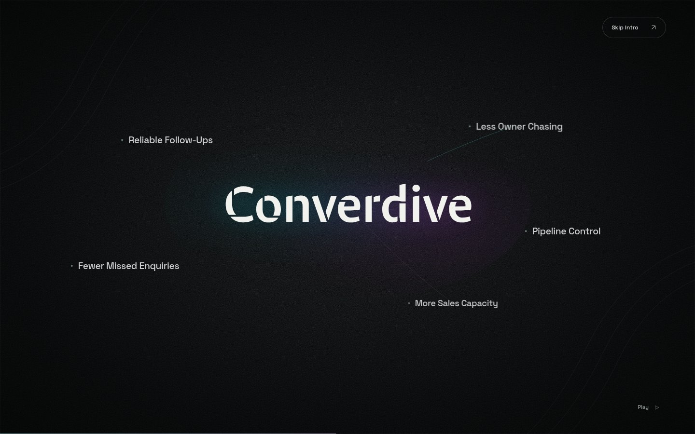
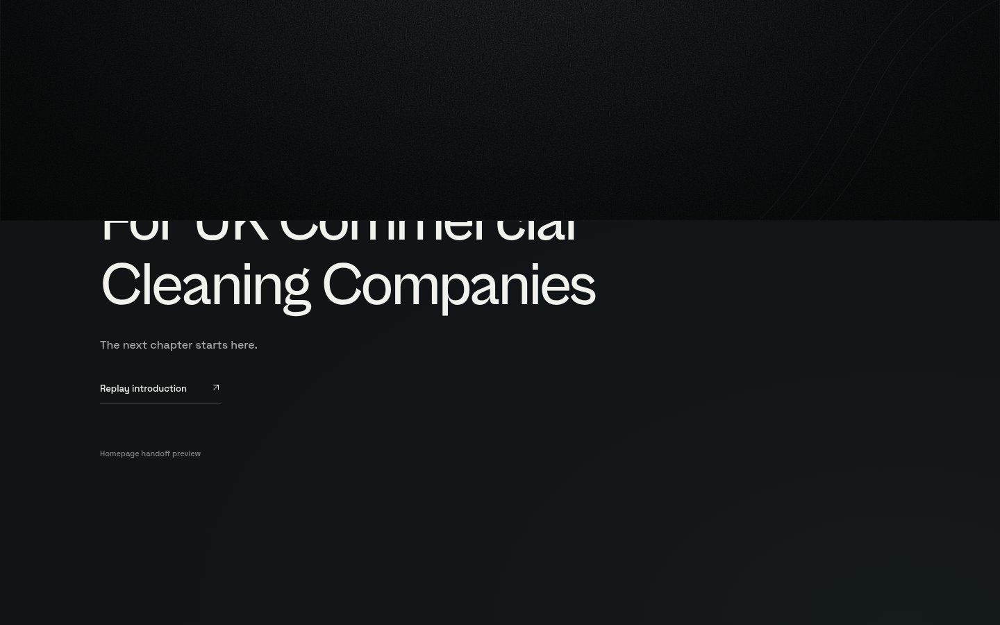
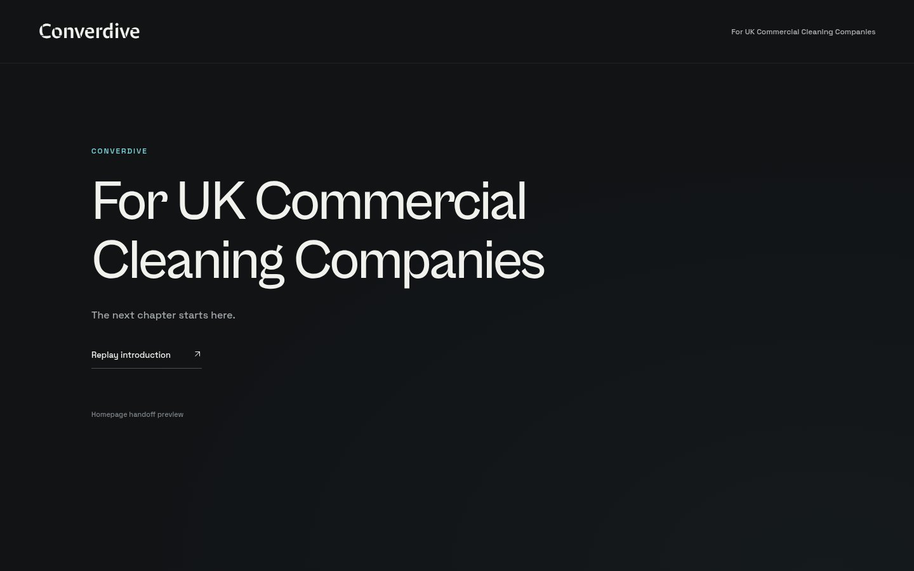
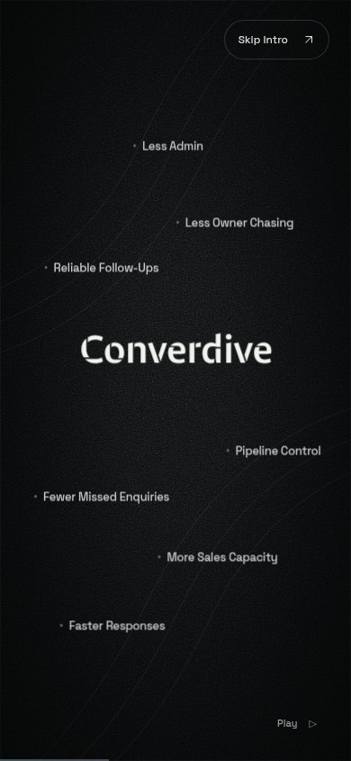
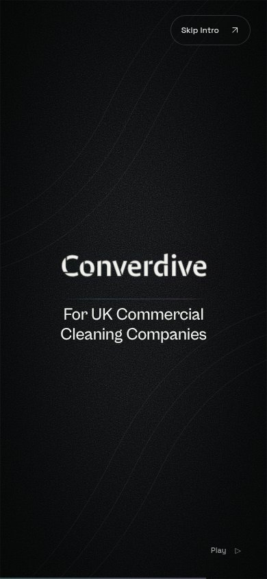

# Opening animation — review snapshot

This is the first functional splash, pending integration of the approved logo's
image file and Cabinet Grotesk Semibold. It currently shows the supplied stencil
wordmark. The homepage is a handoff placeholder only.

Download **[converdive-intro.html](converdive-intro.html)** using GitHub's
“Download raw file” button. All JavaScript, CSS and fonts are embedded.
For representative browser storage behavior, serve this folder:

```sh
python3 -m http.server 4173 --directory docs/preview
```

- Playback: `http://localhost:4173/converdive-intro.html?intro=1`
- Scrub and review: `http://localhost:4173/converdive-intro.html?intro=review`

For source development, use `npm run dev` and `http://localhost:5173/?intro=review`.
This snapshot is a downloadable preview, not a hosted deployment.
The cloud browser's administrator policy blocks `file://` URLs; the production
HTTP preview is the version validated in Chromium.

The following requested screenshots are retained as review deliverables, with
the scrubber hidden. These are deliberate snapshots, not browser cache output.

| Reading hold | Magnetic attraction |
| --- | --- |
|  |  |

| Energy transfer | Positioning |
| --- | --- |
|  |  |

| Upward handoff | Permanent header after playback |
| --- | --- |
|  |  |

| Mobile reading hold | Mobile positioning |
| --- | --- |
|  |  |

[Browser check results](checks.json) · [Implementation and asset inventory](../opening-splash.md)
