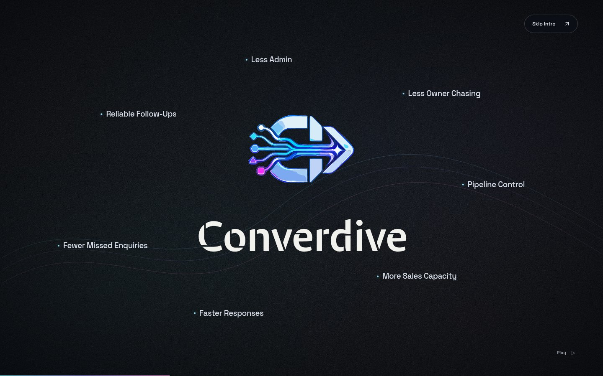
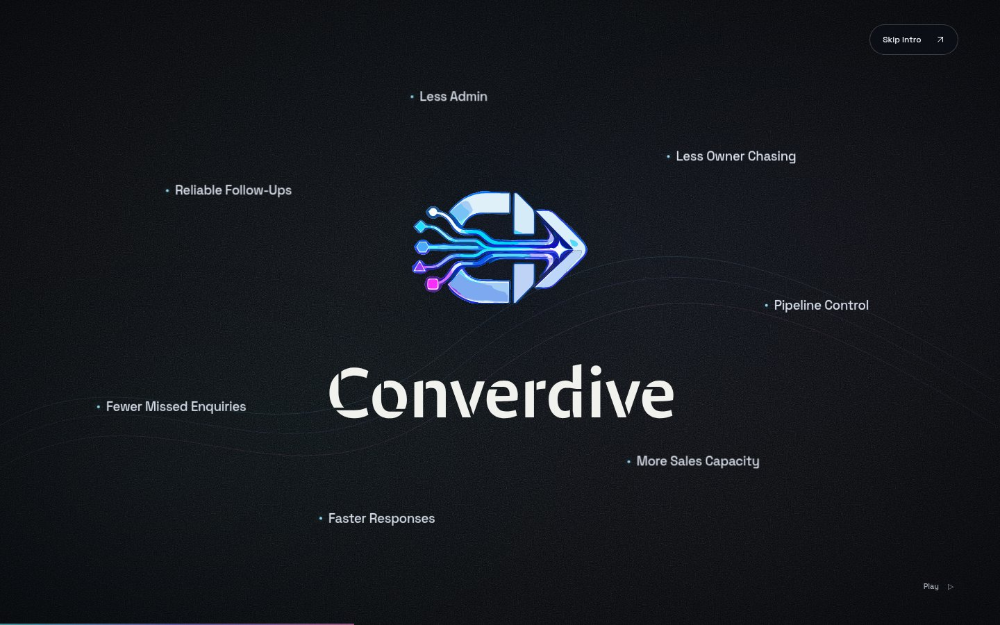
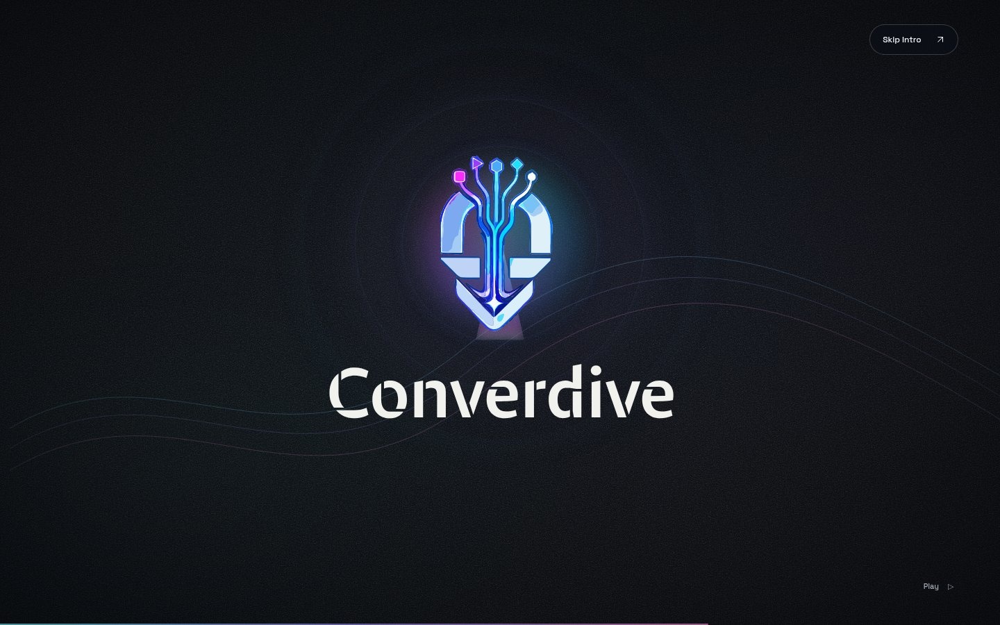
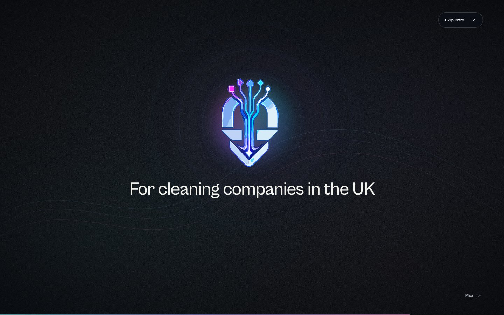
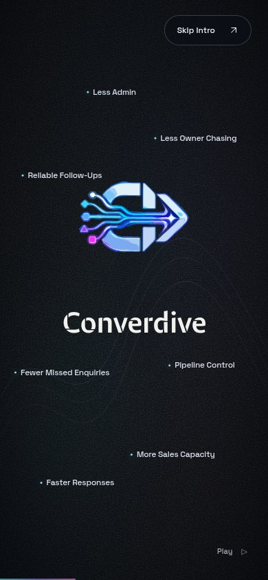

# Converdive intro review

[Play the private preview](https://converdive-intro-preview.longgala1.chatgpt.site/?intro=1) · [Pause and scrub the sequence](https://converdive-intro-preview.longgala1.chatgpt.site/?intro=review)

Sign in with the owning ChatGPT account if prompted. The hosted preview is the easiest way to review; localhost works only with a server running on your computer.

The [standalone HTML](converdive-intro.html) contains the current intro, assets, CSS, and JavaScript. To serve it locally, run `python3 -m http.server 4173 --directory docs/preview` from the repository root and open `http://localhost:4173/converdive-intro.html?intro=review`.

| Outcomes | Magnetic field | Beam | Final state | Mobile |
| --- | --- | --- | --- | --- |
|  |  |  |  |  |

[Browser check results](checks.json) · [Implementation and asset notes](../opening-splash.md)

Private Sites project: `appgprj_6ae9246de40481918121f5e6f21b7ab6`. Deployed source commit: `858459f91ca92dac1b4a4a9e25d20a292f8dba40`.
