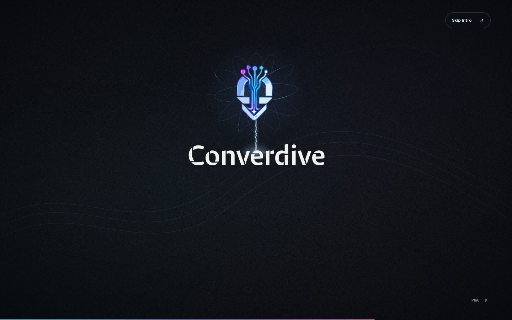

# Converdive — reconstructed intro

[Play the private preview](https://converdive-intro-preview.longgala1.chatgpt.site/?intro=1) · [Seek and pause](https://converdive-intro-preview.longgala1.chatgpt.site/?intro=review)

The existing identity, exact text colors, fonts, controls and homepage handoff are preserved. The sequence lasts 8.2 seconds.

| Time | Behavior | Capture |
| --- | --- | --- |
| 1.5s | All seven phrases orbit | [Desktop](1440-1500.jpg) · [Mobile](390-1500.jpg) |
| 3.5s | Attraction begins, field responds | [Desktop](1440-3500.jpg) · [Mobile](390-3500.jpg) |
| 4.5s | Curved, masked absorption | [Desktop](1440-4500.jpg) · [Mobile](390-4500.jpg) |
| 5.4s | Concentration and rotation | [Desktop](1440-5400.jpg) · [Mobile](390-5400.jpg) |
| 5.8s | Beam propagates | [Desktop](1440-5800.jpg) · [Mobile](390-5800.jpg) |
| 6.0s | Beam impact | [Desktop](1440-6000.jpg) · [Mobile](390-6000.jpg) |
| 6.8s | Three-line text reveal | [Desktop](1440-6800.jpg) · [Mobile](390-6800.jpg) |
| 7.6s | Resolved final state | [Desktop](1440-7600.jpg) · [Mobile](390-7600.jpg) |

[Continuous playback recording](playback.webm) · [Consecutive recording frames](motion-sheet.jpg) · [24 browser checks](checks.json) · [Viewport and color evidence](geometry-checks.json)

`scene.ts` measures the logo and wordmark and derives all trajectories. `energy.ts` renders deterministic Canvas 2D field planes, localized absorption responses, irregular beam filaments and impact. Existing WAAPI effects and the VFX share one seekable clock. The original logo SVG is unchanged. No new runtime dependencies were added.

Skills applied: Motion Design for continuity, staged cause/effect and acceleration; Taste for hierarchy, negative space and the screenshot look/fix pass; Impeccable for identity preservation, bounded effects, accessibility and its final detector (no findings); Playwright CLI for rendering, tests, recording and captures. Hairline was inspected; its isometric redraw engine was not used because this task preserves the exact artwork.

Verified: TypeScript/Vite build and 24 Chromium checks. Sampled trajectories at 1366×768, 1440×900, 1920×1080 and 390×844 showed no phrase/name overlap or clipping. All seven phrases remain readable during orbit. Checked complete playback, beam endpoints, backward scrubbing, original type/color values, energy cleanup, Skip Intro, returning visits and reduced motion. Recorded continuous playback and inspected consecutive frames from it.

Limitations: The three reference images mentioned in the brief were absent from the available attachments. The VFX follow the detailed written descriptions; image-by-image matching remains unverified. This is a restrained procedural 2D approximation of plasma, not a volumetric fluid simulation. Physical-device performance and Safari/Firefox are unverified.

Deployed Sites snapshot: `579cc9ae5b4dd714d09db98a6c71a603b360152c`. Owner-private project: `appgprj_6ae9246de40481918121f5e6f21b7ab6`.
